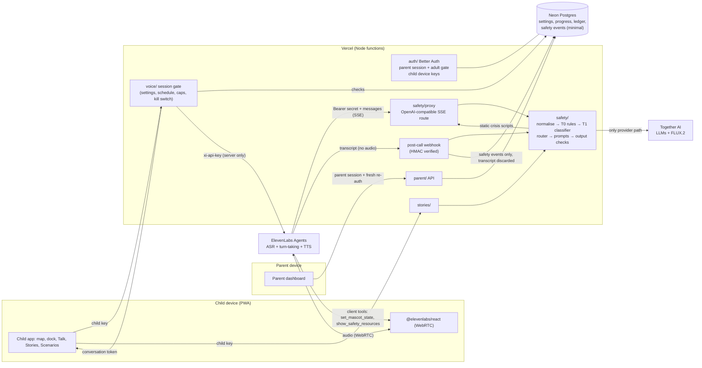

# Feelio architecture (Milestone 0 proposal, awaiting approval)

> Proposal only. Nothing is scaffolded yet. Provider facts were verified on 2026-10-10 (sources in `docs/DECISIONS.md`). Items marked **(verify in M1/M4)** are design assumptions that must be proven by a running test before we build on them.

## 1. Stack (recommended)
| Layer | Choice | Why (details in DECISIONS.md) |
|---|---|---|
| App + API | **Next.js (App Router, TypeScript), Node.js runtime route handlers** on Vercel Hobby. Not FastAPI | One language end to end. ElevenLabs React SDK, Better Auth and Drizzle are TypeScript. Streaming route handlers fit the custom-LLM proxy. Vercel now recommends Node over Edge (Edge is unsupported from Next.js 16.3). D-001 |
| Hosting | Vercel Hobby: 300 s max function duration (Fluid Compute), 4.5 MB request and response bodies, single region, set to `fra1` (Frankfurt, D-030), daily-only cron | Dev and small pilot only. Hobby is personal and non-commercial, with no DPA (D-010) |
| Database | **Neon** Postgres (free tier) + Drizzle ORM | Plain Postgres, branches for previews, Vercel integration. Synthetic data only (no DPA on free tiers) |
| Auth | **Better Auth** (MIT, self-hosted in our Postgres) | §6, D-002 |
| Voice | ElevenLabs Agents, WebRTC, custom LLM → our proxy | §4, D-003 and D-004. **Usage-policy blocker: D-005** |
| LLMs | Together AI: voice `Qwen/Qwen3.5-9B` (reasoning off), fallback `meta-models/Muse-Glimmer-30B`; stories `zai-org/GLM-5.3-Flash`; T1 safety classifier `Qwen/Qwen3.5-9B` (JSON schema); images `black-forest-labs/FLUX.2-dev` with `reference_images` | D-007, D-008. All to be benchmarked (EN + AR, latency, red-team) in M2/M4/M5 |
| UI | React, CSS Modules + CSS custom-property tokens (logical properties for RTL), `motion` for animation, `@use-gesture/react` for pan, pinch and drag, Lucide for functional icons | §5. No game engine (SPEC §4.1) |
| i18n | `next-intl` (ICU plurals, RTL via `dir`) | Arabic plural forms |
| PWA | Web app manifest + Serwist service worker (`@serwist/next`) | Maintained successor of next-pwa. Precaches the shell and map; never caches API or child data |
| Tests | Vitest (unit), Playwright (e2e, both orientations, EN and AR), red-team runner (Node) | |

## 2. Modules
```
app/                       Next.js routes: (child)/, (parent)/, (dev)/editor, api/
safety/                    THE ONLY place that calls model providers
  normalise/  rules/  classify/  router/  prompts/  fallbacks/  images/  proxy/  posthoc/  tests/redteam/
voice/                     session gate, agent_config.json, client tools contract, mascot-state mapping
stories/                   request → safety → text (JSON schema) → images → safety → pages
games/                     scenario player (authored content only), progress
world/                     pack loader, world.json schema (zod), unlock engine, map renderer, hotspot editor (dev)
mascot/                    state machine, pose registry (from assets/manifest.json), idle/blink/mouth controllers
parent/                    dashboard, settings, insights, consent, export and delete
auth/                      Better Auth config, parent session, adult gate (fresh re-auth), child device keys
design/                    tokens (from brand/BRAND.md), components shared by child and parent apps
platform/                  db (Drizzle), config and kill switches, usage ledger, caps, rate limits, retention cron
content/worlds/<pack>/     world.json, scenarios/, strings, pack metadata (data only)
content/safety/            resources.<locale>.json, fixed scripts, static audio manifests (reviewed)
scripts/                   sync_voice_agent (ElevenLabs API), asset build (PNG → WebP/AVIF), redteam runner
```
**Import boundary (enforced by an ESLint rule):** only `safety/` may import Together or ElevenLabs server SDKs or call their hosts. `app/api/*` routes call `safety/`, `voice/` and `platform/`, and never providers directly.

## 3. System diagram


## 4. Voice: session gate and safety proxy
### 4.1 Session gate (`POST /api/child/voice/session`), the server-side enforcement point (CR-2)
In order, failing closed:
1. Valid child device key with the `voice:start` permission, and the device not revoked.
2. The parent has voice enabled for this child, the current time is inside an allowed schedule window (household timezone), and screen time remains today.
3. Per-child daily voice cap (seconds) and per-household cap from the usage ledger.
4. Global switches: `voice_enabled`, the credit budget not exhausted, and the provider-approval flag (D-005) set for real-child use.
5. At most one active voice session per child.
6. Fetch a **WebRTC conversation token** from ElevenLabs (`GET /v1/convai/conversation/token?agent_id=…`, server-side with `xi-api-key`). The agent has `enable_auth: true`, so it cannot be started without a token we minted.
7. Write `voice_session {id, child_id, el_conversation_id, age_band, locale, place_id, scenario_id?, allowed_seconds, started_at}` and return `{token, sessionId, allowedSeconds}`.

If any check fails, the client gets a reason code and the Talk screen degrades (§9). It is never a dead screen.

### 4.2 Agent configuration (as code: `voice/agent_config.json`, synced by `scripts/sync_voice_agent`)
- `llm: "custom-llm"`, `custom_llm.url = https://<app>/api/voice/llm` (chat_completions), `api_key` = workspace secret (Bearer) that our proxy checks. `backup_llm_config.preference = "disabled"`. Verified: with a custom LLM, ElevenLabs retries the same endpoint and does **not** fall back to hosted models.
- `max_duration_seconds`: 300 (backstop; our own per-session limit is shorter). `silence_end_call_timeout`: 30 s. `turn_timeout`: 7 s. `call_limits.daily_limit` set. `bursting_enabled: false` (bursts bill at 2×).
- Overrides: only `language` enabled. Prompt, LLM, voice and max-duration overrides stay disabled (client-supplied values can be tampered with).
- Privacy: `record_voice: false`, `retention_days` minimal (0 = scheduled deletion), `delete_audio: true`; per-agent zero-retention mode if our plan allows it **(verify)**. Workspace webhooks: `transcript` and `call_initiation_failure` only, **no `audio`**.
- Native guardrails (Content, Manipulation, Focus) on as an **extra** layer, never the main one.
- Client tools: `set_mascot_state(state: enum)` and `show_safety_resources(kind: enum)`, non-blocking.
- Language: `language_presets` for `en` and `ar`. The TTS model must support Arabic (Eleven v4 Turbo or Flash v2.5; choose by measured latency and Arabic quality).

### 4.3 The proxy route (`POST /api/voice/llm`, streaming SSE)
1. Reject unless the Bearer secret matches. Strip `elevenlabs_extra_body`.
2. Bind to our session. **Verified (D-068):** `request_headers` dynamic variables are *not* substituted, so the app passes our opaque session id in `customLlmExtraBody` (the agent allows only that override) and the proxy looks it up server-side. ElevenLabs calls `<url>/chat/completions`. **Age band, locale and place come from our DB, never from the client.**
3. Time check: if `now − started_at ≥ allowed_seconds`, stream the static goodbye line and an `end_call` tool call.
4. Take the latest user turn → `safety.checkInput` (T0 synchronous; a crisis hit short-circuits to a fixed script plus a `show_safety_resources` tool call plus `set_mascot_state: calm`).
5. Start generation (Together, streaming) **in parallel** with the T1 input classification. Hold tokens until T1 returns. Then, in strict mode (the default for every age, D-018), each sentence also passes T1 before release (`docs/SAFETY_POLICY.md` §3).
6. Split the stream into sentences. Each sentence passes T0 output rules (and T1 in strict mode) before it is written as an SSE chunk. A failure swaps in a reviewed fallback and drops the rest of the turn.
7. Optionally emit `set_mascot_state` (empathy, happy, calm…) chosen by **our** router from the classification, not left to the model. **Verified (D-068):** `tool_calls` returned by the custom LLM reach the browser as client tool calls. The model may choose mood, feeling card, breathing and place tools (allowlisted, validated twice); the crisis tool comes only from the router.
8. Buffer words: if T1 or the model is slow, stream "Hmm… " (with the trailing space ElevenLabs requires) and/or rely on the agent's `soft_timeout_config`. The first token must arrive within `cascade_timeout_seconds` (default 4 s, raise to 6–8).
9. After the turn, a background T1 check of the full reply updates the session's risk state (switching strict mode on if needed).

### 4.4 Post-call
The webhook (`ElevenLabs-Signature` HMAC + timestamp, via `constructEvent`) → second-pass classification of the transcript → minimal safety events → transcript discarded. Usage: `call_duration_secs` goes into the ledger (budget tracking).

### 4.5 Fallback if the custom-LLM path fails in M4 testing
Keep ElevenLabs only for speech: browser mic → ElevenLabs STT (single-use token) → our `safety/` route (normal request/response) → ElevenLabs TTS streaming → play. The in-line check stays fully ours. Costs: more round trips (higher latency), our own turn-taking and barge-in logic, and STT plus TTS billed per use. Native guardrails alone are **not** an acceptable substitute (alpha, end-call-only in streaming mode).

## 5. The interactive global map (current scope)
### 5.1 What the two images show (viewed 2026-10-10)
Both are 2:3 / 3:2 PNGs (horizontal 1536×1024, 2.0 MB; vertical 1024×1536, 1.8 MB), opaque RGB, bright cartoon style, top-down three-quarter view with light from the top-left. A beige path links **five empty round stone pads**, and five landmarks sit beside the path:
| Place | What it looks like | Order on the path |
|---|---|---|
| House (= "home") | Cream cottage, red roof, porch with flowers, chimney | 1 (start: left in H, bottom in V) |
| Park | Big tree with a rope swing, pond with lily pads and a wooden arched bridge, reeds | 2 |
| School | Yellow school with a red roof, clock, blue double doors, **red pennant flag** on the bell tower | 3 |
| Club | Yellow and blue clubhouse with a curved roof, a red-curtained stage with bunting, a drum | 4 |
| Market | Three stalls with red, blue and yellow striped awnings (fruit, potted flowers, bread) | 5 (end) |

**Issues found:**
1. **Painted English words on all five signs** ("House", "School", "Market", "Park", "Club"). They can't be localised to Arabic, can't be mirrored (the words would be reversed), and break the protocol's no-text rule. Resolution (D-021): English keeps these maps. The owner generates Arabic-sign versions (`map-h-ar`, `map-v-ar` in `docs/ASSET_REQUESTS.md`). Neither is mirrored.
2. The art says **"House"** while the spec says **"Home"**. Proposal: data id `home`, displayed name "Home" / "البيت" (Q-list).
3. The school's red pennant is a generic flag, not a national one. ART_DIRECTION says "no flags", so please confirm it's fine.
4. The file is named `global_horizental.png` (typo). Proposal: the build step reads it as is, and you rename it whenever convenient.
5. The order **House → Park → … ** matches the MVP slice (Park and Home first).

### 5.2 Measured positions (fractions of the image; to be refined with the dev editor)
| | Horizontal place centre (x, y, r) | Horizontal pad | Horizontal sign | Vertical place centre (x, y, r) | Vertical pad | Vertical sign |
|---|---|---|---|---|---|---|
| home | 0.17, 0.22, 0.12 | 0.09, 0.46 | 0.09, 0.32 | 0.77, 0.80, 0.16 | 0.36, 0.83 | 0.67, 0.875 |
| park | 0.22, 0.78, 0.14 | 0.31, 0.57 | 0.15, 0.85 | 0.20, 0.60, 0.18 | 0.66, 0.61 | 0.10, 0.645 |
| school | 0.50, 0.24, 0.12 | 0.495, 0.47 | 0.58, 0.37 | 0.80, 0.43, 0.17 | 0.34, 0.44 | 0.92, 0.50 |
| club | 0.70, 0.76, 0.12 | 0.69, 0.59 | 0.62, 0.86 | 0.24, 0.28, 0.17 | 0.68, 0.27 | 0.11, 0.33 |
| market | 0.83, 0.22, 0.12 | 0.90, 0.47 | 0.85, 0.32 | 0.76, 0.11, 0.17 | 0.36, 0.135 | 0.79, 0.165 |

`r` is a fraction of the image width. Pads are ovals (`rx` of the width, `ry` of the height) measured from the art (D-054). The hotspot covers the landmark **and** its pad. Each place gets one tap target, the union of a landmark circle and a pad circle, never smaller than 72 px on screen.

### 5.3 `content/worlds/base/world.json` (proposed schema, validated with zod at build time)
```jsonc
{
  "schema": 1,
  "pack": {
    "id": "base", "name": {"en": "Feelio's World", "ar": "عالم فيليو"},
    "region": null, "languages": ["en", "ar"], "status": "draft",
    "enabled_markets": ["*"], "reviewers": [], "content_review_status": "draft",
    "style_addendum": null, "version": "0.1.0"
  },
  "maps": {
    "horizontal": {
      "assets": {"en": "map.global.horizontal", "ar": "map.global.horizontal.ar"},   // ids in assets/manifest.json → file + derived WebP/AVIF sizes; a missing locale falls back to "en"
      "label_mode": "painted",                        // "painted" (words in the art) | "blank_signs" (code draws names at each place's "sign" anchor; for future languages)
      "size": [1536, 1024],
      "rtl_mirror": "none",                           // "none" | "mirror" (allowed only with label_mode "blank_signs"; D-021)
      "locale_overrides": {},                         // e.g. {"ar": {"places": {...}}} only if an edited map moved something (written by the hotspot editor)
      "path": [[0.0,0.43],[0.09,0.46],[0.20,0.48],[0.31,0.57],[0.40,0.53],[0.495,0.47],[0.58,0.52],[0.69,0.59],[0.80,0.53],[0.90,0.47],[1.0,0.47]],
      "places": {
        "home":   {"hotspot": {"x":0.17,"y":0.22,"r":0.12}, "pad": {"x":0.09,"y":0.46,"r":0.06}, "sign": {"x":0.09,"y":0.32,"w":0.07}, "path_index": 1},
        "park":   {"hotspot": {"x":0.22,"y":0.78,"r":0.14}, "pad": {"x":0.31,"y":0.57,"r":0.06}, "sign": {"x":0.15,"y":0.85,"w":0.07}, "path_index": 3}
        // school, club, market …
      }
    },
    "vertical": { "assets": {"en": "map.global.vertical", "ar": "map.global.vertical.ar"}, "label_mode": "painted", "size": [1024,1536], "rtl_mirror": "none", "path": [[0.57,1.0],[0.45,0.91],[0.36,0.83],[0.42,0.70],[0.66,0.61],[0.50,0.52],[0.34,0.44],[0.50,0.35],[0.68,0.27],[0.50,0.19],[0.36,0.135],[0.52,0.0]], "places": { /* … */ } }
  },
  "places": [
    {
      "id": "home", "order": 1,
      "name": {"en": "Home", "ar": "البيت"},
      "alt": {"en": "A cosy house with a red roof and a flower porch", "ar": "…"},
      "audio_description": {"en": "audio/world/base/home.en.mp3", "ar": "audio/world/base/home.ar.mp3"},
      "unlock": {"type": "always"},
      "levels": [
        {"id": "home-1", "order": 1, "title": {"en": "Leaving for school", "ar": "…"},
         "scenario_ids": ["home-1-a", "home-1-b"], "unlock": {"type": "previous_level_completed"},
         "age_bands": ["5-6", "7-9", "10-12"]}
        // … about 5 levels
      ],
      "voice_context": {"en": "the child is at Home in Feelio's world", "ar": "…"}   // non-personal context for Talk
    },
    {"id": "park", "order": 2, "unlock": {"type": "levels_completed", "place": "home", "count": 3}, "...": "…"}
  ],
  "travel": {"enabled": false, "unlock": {"type": "levels_completed_total", "count": 15}, "destinations": []}
}
```
**Unlock rule language (data, evaluated on the server):** `always` · `previous_level_completed` · `levels_completed {place, count}` · `place_completed {place}` · `levels_completed_total {count}` · `all_of [...]` · `any_of [...]` · `feature_flag {key}`. Unknown rule types fail closed (stay locked) and fail the build's schema validation.

**Packs:** `content/worlds/<pack-id>/` with the same shape. Discovered at build time (a generated registry of folders, no code edits). Visibility = `pack.status == "live"` AND the market is in `enabled_markets` AND the per-market feature flag is on AND the parent hasn't switched the destination off (server check). Strings for a pack live in the pack. Crisis resources stay locale-driven, never pack-driven.

### 5.4 Rendering, gestures and animation
- **Choosing the map:** use the viewport aspect ratio (`width/height ≥ 1` → horizontal, else vertical). Not the orientation API, which iOS PWAs handle unreliably. A `ResizeObserver` and `matchMedia` switch the map without a reload. State that survives a switch: the selected place, the open place card, and the camera **focus as a place id** (re-centred on the same place in the other map), never pixel offsets.
- **Layering:** a "map stage" element at the image's natural aspect holds the `<picture>` (AVIF and WebP `srcset` at 768/1024/1536/2048 widths + a 1–2 KB blurred placeholder), the hotspot buttons, the sign labels and the marker, all positioned in **percent** of the stage. The whole stage gets one CSS `transform: translate3d() scale()`, so everything stays aligned at any zoom. Overlays (badges, labels, the mascot) are counter-scaled to stay readable and keep 72 px targets.
- **Pan and zoom:** `@use-gesture/react` (drag, pinch, wheel, double-tap) drives `motion` values, with the GPU transform only. No React re-render per frame, so 60 fps is achievable on a mid-range tablet. The whole map fits the area above the dock at scale 1 ("contain", D-054); spare space is the map's meadow colour. The camera centres the map on any axis where it is smaller than the area and otherwise clamps at its edges. Maximum 2.5×. Double-tap a place animates the zoom to it. Inertia comes from springs. `touch-action: none` on the stage only.
- **Place states (from server progress):** locked (CSS `filter: saturate(.35) brightness(.95)` on a clipped copy of the landmark area plus `badge_lock`; a tap gives a gentle shake, and the mascot shows `mascot_happy` with the spoken line "Not yet! Let's finish {previous place} first."), unlocked, current (`ring_current` with a slow scale pulse), completed (`badge_star`). Reduced motion: no shake, pulse or walk, just a fade.
- **Mascot marker:** stands on the current place's pad. When a place unlocks, it walks along the `path` polyline from the old pad's `path_index` to the new one. Arc-length parameterisation of the polyline in stage coordinates; `motion` animates `t: 0 → 1` at a constant speed (about 120 px/s of on-screen distance, capped at 3 s). The pose is `mascot_walking_left` or `mascot_walking_right`, chosen from the **on-screen** x-direction of the current segment, so it stays correct after RTL mirroring. A small hop bob (translateY sine) gives the walk. On arrival: `mascot_excited` for 1.2 s, then `mascot_marker`. Missing poses show a grey `TODO(PLACEHOLDER)` box of the same size.
- **Place card:** bottom sheet in portrait, side panel (inline-end) in landscape on tablets. It shows the name (from data, in the current language), a code-drawn level path of `node_*` images with code numbers, the lock, star and check badges, and one big Play button. No illustration until assets arrive (or a code crop of the landmark from the current-language map).
- **Dock:** fixed at the bottom with 4 big buttons (Map, Talk, Stories, My collection). `dock_*` images sit on code-drawn tint tiles, with labels and audio cues. Reading-direction order. Settings and the parent area are reachable only through the adult gate, never on the dock.
- **RTL:** UI chrome uses logical CSS and mirrors. **Maps are not mirrored** (D-021): Arabic uses its own Arabic-sign map with the same composition, so the journey reads left to right (horizontal) or bottom to top (vertical) in both languages. The renderer still supports `rtl_mirror: "mirror"` (image layer `scaleX(-1)`, data `x → 1 − x`) for a future blank-sign map. The mascot, badges and labels are never mirrored.
- **Accessibility:** each hotspot is a `<button>` with a localised name ("Park, unlocked, 2 of 5 levels done") and an audio-description button. Focus order follows `order`. Arrow keys move along the path. The map also has a plain list view toggle for screen-reader users.
- **Dev-only hotspot editor:** route `app/(dev)/editor`, returning `notFound()` unless `NODE_ENV === 'development'` **and** excluded from the production build (a build-time env flag removes the route; a CI test asserts that `/editor` returns 404 in the production build). It shows both maps, draggable circles for hotspots, pads, sign anchors and path vertices (add or remove points), a live mirrored preview, and **Export** (download plus copy JSON). It never writes to the server.
- **Performance budget:** map image ≤ 500 KB at the chosen width (AVIF, likely about 150–250 KB), map screen JS ≤ 150 KB gzipped, and page weight reported per screen in CI (Playwright plus a size report).

### 5.5 PWA shell
Manifest `display: "standalone"` (fullscreen where supported), `orientation: "any"`, icons from the brand's simplified logo on a lilac tile. `100dvh` layout with no page scroll, and `env(safe-area-inset-*)` padding. The Serwist service worker precaches the shell, fonts, map images and approved mascot images (cache-first), uses network-only for `/api/*`, and **never caches child data or responses**. Offline: the map and authored scenarios already played still work, and Talk shows `mascot_sleeping` with "I'm resting. Let's talk when we're back online." Install prompt only inside the parent area.

## 6. Authentication and scopes
- **Parents** (the only accounts): Better Auth with email + password **and** email OTP or magic link, optional TOTP 2FA and passkeys. Sessions use httpOnly, Secure, SameSite=Lax cookies.
- **Adult gate:** every parent-area route requires a parent session **plus** a fresh re-authentication (password, OTP or TOTP verified within the last 5 minutes; stored server-side). Sensitive actions (delete data, change limits, enable voice) require it again. Not a math puzzle: children can solve those. Per-market alternatives go in configuration.
- **Child devices:** from the parent area, "Set up this device for Mia" issues a Better Auth **API key** (`configId: child-device`) bound to `{household_id, child_id}` with permissions `child:*` only (`voice:start`, `story:create`, `progress:write`, …). It expires after 30 days, is rate-limited, revocable from the dashboard, and stored in an httpOnly cookie. **Verify in M1** that keys are hashed at rest. **Do not use** Better Auth's device-authorization plugin: it would hand the child the parent's session.
- **Enforcement:** route groups `api/parent/*` (session + fresh check) and `api/child/*` (device key + permission). A shared guard rejects the other scope. Tests prove that a child key gets 403 on every parent route, and that a parent setting can't be bypassed by a direct API call (SPEC §5.4).

## 7. Data model (Postgres; proposed retention needs your approval)
| Table | Key fields (minimal) | Retention / deletion |
|---|---|---|
| Better Auth tables (`user`, `session`, `account`, `verification`, `apikey`, `twoFactor`, `passkey`) | parent identity only | Until account deletion (hard delete) |
| `household` | id, market, timezone, locale | Account lifetime |
| `consent_record` | household, method, policy version, timestamp, market | Account lifetime + legal hold period (counsel) |
| `child_profile` | id, household, nickname (optional, encrypted, **never sent to any provider**), age_band, locale, accessibility; My room (D-074): `avatar.wear` (worn item ids), `rewards_reached`, `rewards_seen` (two counters) | Until the parent deletes it (all deleted with the profile) |
| `child_settings` | features on/off, daily limits per feature, schedule windows, voice on/off, content preferences | Same |
| `progress` | child, pack, level, scenario, completed_at | Same |
| `collection_item` | child, item id, earned_at | Same |
| `usage_ledger` | child, household, date, feature, seconds, tokens, credits_est | 90 days, then aggregated |
| `voice_session` | id, child, el_conversation_id, age_band, locale, place, started/ended, seconds, end_reason. **No transcript** | 30 days |
| `story` | child, created, theme tag, language, 4 page texts, image refs, safety status | 90 days or until deleted (proposal) |
| `story_image` (blob store) | generated images | Deleted with the story |
| `safety_event` | child, category, severity, actor_class, feature, created | 90 days (policy §7) |
| `safety_excerpt` | event, redacted excerpt ≤ 200 chars, encrypted with a per-event key | 30 days, crypto-shred |
| `safety_event_counts` | date, category, count | Indefinite (no child content) |
| `config` | kill switches, budgets, provider-approval flags | n/a |
| `audit_log` | parent setting changes (who, what, when) | 1 year |
Deletion cascades from `child_profile` and `household`, and to providers where an API exists (ElevenLabs conversation delete, Together ZDR). Retention runs as a **daily** Vercel cron (Hobby allows daily at most).

## 8. Mascot state machine
**One controller per mascot instance**, driven by events. It renders delivered pose images only. Idle motion (breathing scale 1.0↔1.02, antenna bob via a small rotate on the whole image, blink swap to `mascot_idle_blink` every 3–6 s) uses CSS transforms. Reduced motion: pose swaps with a fade only.

### 8.1 Talk screen
```
            start tapped / token ok
 [idle] ─────────────────────────────▶ [connecting] (idle + gentle pulse on the mic)
   ▲                                        │ onStatusChange=connected
   │                                        ▼
   │   onModeChange=listening      ┌──▶ [listening] ◀──────────────┐
   │                               │        │ user turn ends        │ child barges in
   │                               │        ▼ (final transcript)    │ (mode→listening)
   │                               │   [thinking]                   │
   │                               │        │ onModeChange=speaking │
   │                               │        ▼                       │
   │                               └── [speaking] ── mouth frames by getOutputVolume()
   │                                        │          (<0.08 closed · <0.25 half · else open, ~12 Hz)
   │   end tapped / time limit / max-duration / silence timeout
   ├─────────────── [waving] (goodbye line, static audio) ──▶ [idle]
   │
 overlays (an emotion layer, applies to listening/speaking until the next turn):
   set_mascot_state(happy|excited|empathy|calm|proud|confused) → swap the base pose for that emotion pose,
   keep the speaking mouth only if mouth frames exist for it (otherwise the emotion pose plus a gentle bounce)
 forced:  crisis → [calm]/[empathy] locked for the rest of the session (excited, celebrating and proud are blocked)
 errors:  onError / onDisconnect unexpected → [confused] + Retry · offline → [sleeping] · budget or schedule → [sleeping] + "come back later" (warm)
```
- The allowed emotion list is enforced **client-side as an enum** and chosen **server-side** by the safety router. The model cannot pick `excited` during a sad conversation.
- Captions (optional) come from `onMessage`. The "I'm Feelio, a friendly AI" chip with `mascot_head_happy` stays visible at all times and has an audio button.
- Interrupted: when the child speaks during `speaking`, the SDK switches mode → `listening` immediately (barge-in). The mascot changes on that event.

### 8.2 Map
```
[marker_idle] (mascot_marker + idle bob)
   ├─ tap mascot ─▶ [excited 1s] ─▶ opens Talk (if voice allowed, else a friendly line)
   ├─ tap unlocked place ─▶ [happy 0.8s] ─▶ place card opens
   ├─ tap locked place ─▶ [happy + speech line "Not yet!" + lock shake] ─▶ [marker_idle]
   ├─ place unlocked ─▶ [walking_left|right along the path] ─▶ [excited 1.2s] ─▶ [marker_idle at new pad]
   ├─ level completed ─▶ [happy] (+ star badge appears) ─▶ [marker_idle]
   └─ daily time used ─▶ [waving] ─▶ [sleeping]
```

## 9. Degradation path (credits, outages, schedule)
| Level | Trigger | What the child gets |
|---|---|---|
| L0 normal | | Voice, stories with images, scenarios |
| L1 thrifty | Global voice budget < 25% left, or the child near a cap | Shorter sessions (allowed_seconds reduced), narration off by default, `turn` replies capped at 1 sentence |
| L2 no voice | Voice kill switch, budget exhausted, ElevenLabs outage, provider approval missing (D-005), schedule window closed for voice | **Text chat with the mascot**, same `safety/` pipeline. Fixed lines (greeting, breathing, goodbye) play as static audio. No dead screen |
| L3 no generation | LLM kill switch, Together outage or credits exhausted | Authored scenarios, a reviewed starter story library with cached audio, scripted mascot interactions. Talk shows "Feelio is resting," a breathing exercise (static audio) and "talk to a grown-up" |
| L4 offline | No network | Cached shell, map and played scenarios, `mascot_sleeping` |
Switches live in `config` (DB) with env-var defaults. The dev usage report shows credits and tokens per session and per feature (SPEC §3.2).

## 10. Threat model: top 10
| # | Risk | Category | Likelihood × impact | Mitigations |
|---|---|---|---|---|
| T1 | The model produces harmful, sexual or frightening content for a child (jailbreak, role-play, Arabic or Arabizi evasion) | Child safety | Medium × severe | `safety/` pipeline with T0+T1 input, gated output, fixed fallbacks, age-band prompts, short replies, red-team suite in EN and AR in CI, native ElevenLabs guardrails as an extra layer, strict mode after an event |
| T2 | A disclosure (abuse, self-harm) is missed or mishandled; the parent is the abuser | Child safety | Medium × severe | T0 crisis lexicon short-circuit, reviewed scripts, actor-class rule (no tip-off), restricted review queue with a named owner, expert review before the pilot (policy §5) |
| T3 | Generated story images sexualise or depict a minor inappropriately | Child safety | Low × severe | Template-only prompts, forced cartoon style, provider NSFW checker on, our vision check, regenerate-or-fallback, animal or creature characters by default (Q8), no sharing, no uploads |
| T4 | The safety proxy is bypassed (agent repointed, overrides abused, direct provider calls) | Security / safety | Low × severe | Agent as code with a sync check in CI (diff the live config against the repo), overrides disabled, `enable_auth`, Bearer secret on the proxy, no fallback LLM, ESLint import boundary, no ElevenLabs MCP |
| T5 | A child (or anyone) bypasses parental settings by calling APIs directly or tampering with client data | Security | Medium × high | All enforcement server-side, scoped device keys, context read from our DB not the client, a bypass test for every setting |
| T6 | Personal data leaks (names, school, address in transcripts or logs; provider retention) | Privacy | Medium × high | PII redaction before storage, no transcripts stored, no names sent to providers, ElevenLabs `record_voice:false` and minimal retention, Together ZDR, synthetic data on free tiers, logs free of content |
| T7 | Cost abuse: long or looping sessions, scripted token minting, story spam burn the 120k credits | Cost | High × medium | Session gate (one active session, per-child and per-household caps, schedule), `max_duration_seconds`, silence timeout, `daily_limit`, `bursting_enabled:false`, rate limits on token and story routes, global budget meter + kill switch → L2/L3 |
| T8 | Account takeover of a parent → access to child data or settings changes | Security | Low × high | Better Auth with optional TOTP or passkeys, fresh re-auth for the parent area, audit log, email notice on sensitive changes, rate-limited login |
| T9 | Emotional dependency or manipulation by design (the mascot keeps a child engaged) | Child safety / ethics | Medium × medium | No streaks, guilt or pleas; caps and schedules; dependency signals → gentle redirection; time-limit endings are warm and server-enforced |
| T10 | Provider terms and legal exposure: ElevenLabs forbids under-18-directed apps without written approval; Together not directed at under-13s; Vercel Hobby non-commercial and no DPA | Legal / compliance | **Certain × high** | No real children until written ElevenLabs approval, Together confirmation and DPAs exist (D-005, D-009, D-010); the provider-approval flag in the session gate; counsel review (LEGAL_NOTES) |

Also tracked: secret leakage (CR-3, server-only env, CI secret scan); webhook spoofing (HMAC + timestamp); prompt-injection through scenario or world content (authored and reviewed only); supply chain (pinned dependencies, lockfile, Dependabot alerts).

## 11. Scenarios: schema and legacy migration (SPEC §4.3)
**Inventory (2026-10-10): `legacy/artifacts/` is empty** (only `.keep`). Nothing to migrate yet; the plan below runs when the files arrive (Milestone 6, or earlier if you drop them in).

**Schema** (`content/worlds/<pack>/scenarios/<id>.json`, zod-validated):
```jsonc
{
  "id": "park-1-a", "schema": 1,
  "place": "park", "level": "park-1",
  "age_band": "5-6",                         // "5-6" | "7-9" | "10-12"
  "emotion_tags": ["frustration", "patience"],
  "situation": {"en": "…", "ar": "…"},
  "question": {"en": "How might Sami feel?", "ar": "…"},
  "question_type": "feel" ,                  // "feel" | "do" | "both"
  "choices": [
    {"id": "a", "text": {"en": "…", "ar": "…"},
     "feedback": {"en": "…", "ar": "…"},        // supportive, never "wrong"
     "consequence": {"en": "…", "ar": "…"},
     "mascot_reaction": "empathy"}            // from the allowed state list
  ],                                           // 3–4 choices
  "reflection": {"en": "…", "ar": "…"},
  "asset_refs": {"scene": "world.park.swings", "characters": ["cast.sami.sad"]},   // manifest ids; cast sheet first
  "audio_refs": {"en": "…", "ar": "…"},        // pre-generated narration (static)
  "review_status": "draft",                    // draft → expert_reviewed → approved ; only approved ships
  "reviewers": [], "source": {"legacy_file": null, "changes": []},
  "version": "0.1.0"
}
```
**Migration plan:** (1) inventory each artifact (file, scenario count, place, age, emotions, has images or code); (2) extract the **content only** (situation, question, choices, feedback) by reading the source, never running it; (3) map each scenario to a place and level from world.json, rewrite it to the schema, remove right/wrong framing, scoring and timers, and add the AR text as `draft`; (4) set `review_status: draft`, record every change and every dropped item (with the reason) in `content/migration-report.md`; (5) schema validation and the safety red-team check of all text in CI; (6) expert review → `approved`. The MVP slice target is 12 scenarios (Park + Home × 3 levels × 2), adjusted once the artifacts are counted.

## 12. Credentials check (key names only, values never read or printed)
`.env` contains: `ELEVENLABS_API_KEY`, `TOGETHER_API_KEY`. There is no `.env.example` yet (Milestone 1 deliverable).
| Integration | Status |
|---|---|
| Together AI (LLM, classifier, images) | **Can be built for real now** (key present). Measure TTFT and Arabic quality in M2/M4 |
| ElevenLabs Agents (create agent, tokens, TTS for static audio) | **Code can be built and tested with the owner as an adult tester.** Use with real children is **blocked** by the usage policy until written approval (D-005) |
| Auth (Better Auth) | Needs no third-party key. Needs a DB URL + `BETTER_AUTH_SECRET` (generated in M1). Email sending for OTP or magic links needs an email provider (**not chosen, will ask**) |
| Database (Neon) | **Blocked:** no `DATABASE_URL` (free account needed; your action) |
| Vercel deploy | **Blocked:** no project or token (your account; local dev works meanwhile) |
| ElevenLabs webhook secret, proxy Bearer secret | Generated when the agent is created (M4) |
| Email provider (OTP, magic link, safety notices) | **Not chosen.** It's a new third-party service, so I'll ask in M1 |

## Level flow and loading (Milestone 1c)
Place maps, level states, artifacts, progress API and the loading system: see `docs/LEVEL_FLOW.md` (D-056, D-057).

## Safety layer (Milestone 2)
Built as designed in SAFETY_POLICY §2–3: `safety/` (rules, classifier, router, pipeline, events, voice wiring, the only provider client) and `content/safety/` (reviewed data). Decisions D-058 to D-062. The proxy route is `app/api/voice/llm/route.ts` (adult-only spike).

## Parent dashboard and time (Milestone 3)
Time zones and allowed hours: `platform/time.ts` (Luxon), enforced in `child/usage.ts` (`pauseFor`). Parent overview: `parent/insights.ts`. Safety lead: `parent/safety-lead.ts`, page `app/parent/safety`. Decisions D-065, D-066.
